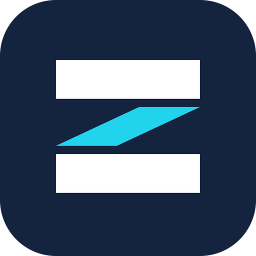

<p align="center">
  
</p>

<h1 align="center">ZAQSA</h1>

<p align="center">
  <strong>Multiple services, one accountable team.</strong><br />
  Software, websites, apps and digital marketing for hospitals, schools, election campaigns and growing businesses.
</p>

---

## About this project

This is the official website of **ZAQSA**, an IT and digital-services company based in New Delhi, founded by Chinmay Anand.

In the first two seconds, the home page tells a visitor what we build and who we build it for: apps and websites, hospitals, schools, campaigns and businesses.

## What the website covers

**Core services**

| Service | What it is |
| --- | --- |
| Election & Political Campaign Management | Campaign websites, voter outreach, social media and event coordination |
| School Management | Admissions, attendance, fees, results, and school administration |
| Hospital Management | Appointments, patient records, billing and reports |
| Website & App Development | Business sites, web apps and mobile apps |
| Small Business Management | Billing, inventory, customers and follow-ups |
| Social Media Management | Content calendars, posts, reels and growth |
| AI & Business Automation | Chatbots, lead handling and workflow automation |
| Graphic Design & Branding | Logos, posters, banners and brand kits |

Marketing and media services are listed on the Services page.

**Pages:** Home · Services (with one page per service) · Industries · Solutions · Technology · Business · About · Lab · Contact · Privacy · Terms

**Also included**
- Responsive layout for phone, tablet and desktop
- Light, modern look with smooth scrolling and a pinned services showcase on the home page
- Custom 404, error and offline pages
- Contact form with input checks
- Basic security headers on every page

## Contact details shown on the site

| | |
| --- | --- |
| Address | Mahavir Enclave, New Delhi – 110045, India |
| Email | zyqotech@gmail.com |
| Phone | +91 9570752983 |

To change any of these, edit the `COMPANY` block in `src/lib/content.ts`. The site updates everywhere.

## Common edits

| I want to change | Where |
| --- | --- |
| Company name, email, phone, address | `src/lib/content.ts` (`COMPANY`) |
| Service names and descriptions | `src/lib/content.ts` (`CORE_SERVICES`, `SERVICES`) |
| Photos | `src/assets/photos/` (credits in `CREDITS.md`) |
| Logo and favicon | `public/` and `src/components/site/LogoMark.tsx` |
| Colours and fonts | `src/styles.css` |

## Run it on your computer

You need Node.js 22 and npm.

```sh
npm ci
npm run dev
```

Then open the address shown in the terminal.

```sh
npm test                                         # run the checks
LOVABLE_NITRO_PRESET=node-server npm run build   # production build
```

## Going live

- **Vercel:** import the repository. No extra settings are needed. Every push to `main` is deployed automatically.
- **Your own server:** the `Dockerfile` builds the site and serves it on port 3000. `/_health` is used to check that it is running.

## Built with

TanStack Start · React · TypeScript · Vite · Tailwind CSS · GSAP · Three.js

Fonts: Fraunces, Hanken Grotesk, Geist Mono.

## Notes

- Consultation requests are emailed to `COMPANY.email` by our own server route (`src/routes/api.contact.ts`) through Resend. **Setup:** create a free Resend account, make an API key, and add it in Vercel under *Settings > Environment Variables* as `RESEND_API_KEY`. Optional: `CONTACT_TO` (where requests go) and `CONTACT_FROM` (a sender on your verified domain). Until the key is added, the form falls back to FormSubmit and then to the visitor's email app, so nothing is lost.
- Team and service photos are stock images. Replace them with your own whenever you have them.

---

<p align="center">© ZAQSA, New Delhi. All rights reserved.</p>
